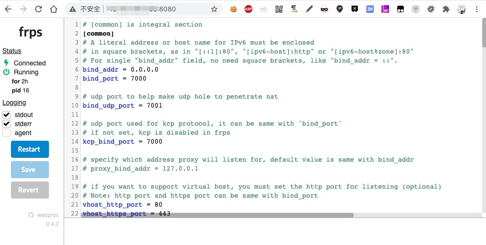
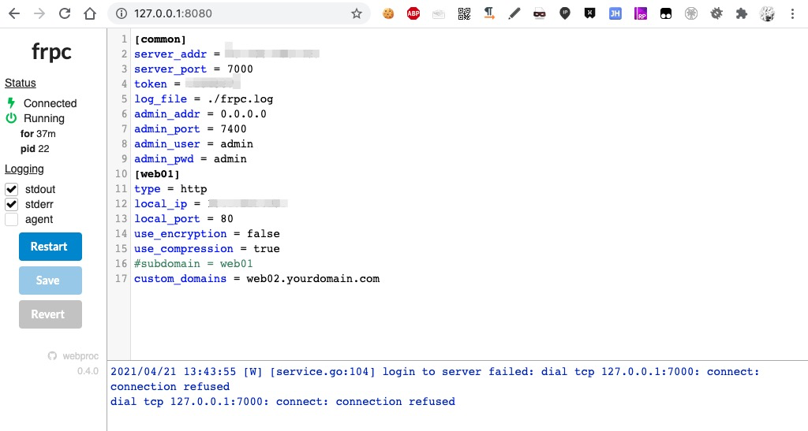

frp内网穿透带web 管理 的docker 镜像
===

Docker Hub 仓库: [mtjo/frp](https://hub.docker.com/r/mtjo/frp)

提供 amd64 和 arm64 多架构镜像，支持自动构建最新版 FRP。

### 启动服务端 frps (推荐使用 latest 标签，自动获取最新版)

```
docker run -itd -p 8080:8080 \
                       -p 7000:7000 \
                       -p 80:80 \
                       -p 443:443 \
                       -p 2000-2020:2000-2020 \
                       -p 7500:7500 \
                       -p 7001:7001/udp \
                       -e "HTTP_USER=admin" \
                       -e "HTTP_PASS=admin" \
                       --restart=always \
                       --name frps \
                       mtjo/frp:frps-latest
```
* frps 容器内配置文件可以通过 `-v /opt/frp/frps_full.ini:/etc/frps_full.ini` 可以挂载到本地实现持久化 
* 端口映射请根据实际配置文件修改（-p 2000-2020:2000-2020 这个端口范围要根据实际使用设置，设置范围太广会大量占用宿主机端口和内存）
* 容器运行后可以通过你的 ip:8080管理服务端配置 http://XXX.XXX.XXX.XXX:8080

### 从 Docker Hub 拉取镜像

```bash
# 拉取最新版 frps（amd64 / arm64 自动适配）
docker pull mtjo/frp:frps-latest

# 拉取最新版 frpc（amd64 / arm64 自动适配）
docker pull mtjo/frp:frpc-latest

# 拉取指定版本
docker pull mtjo/frp:frps-v0.71.0
docker pull mtjo/frp:frpc-v0.71.0
```



### 在本地启动 frpc 客户端 (推荐使用 latest 标签，自动获取最新版)

```
docker run -itd -p 8080:8080 \
			    -p 7400:7400 \
			    -e "HTTP_USER=admin" \
			    -e "HTTP_PASS=admin" \
			    --restart=always \
			    --name frpc \
			    mtjo/frp:frpc-latest
```

* frpc 容器内配置文件可以通过` -v /opt/frp/frpc.ini:/etc/frpc.ini `可以挂载到本地实现持久化
* 通过你的[localhost:8080](localhost:8080)管理客户端配置 [http://127.0.0.1:8080](http://127.0.0.1:8080)




## 当然也许没有合适你的frp版本你也可以自己通过dockerfile生成自己的镜像

### 生成frps (修改FRP_VERSION为对应版本号)
```
docker build -f DockerfileFrps --build-arg FRP_VERSION="0.36.2" -t mtjo/frp:frps-v0.36.2 .
```

### 生成frpc(修改FRP_VERSION为对应版本号)
```
docker build -f DockerfileFrpc --build-arg FRP_VERSION="0.36.2" -t mtjo/frp:frpc-v0.36.2 .
```

webui 使用的是[webproc](https://github.com/jpillora/webproc) 感谢 jpillora

## 自动化构建 (GitHub Actions)

本仓库配置了 GitHub Actions 工作流 (`.github/workflows/docker-image.yml`)，自动构建并推送多架构镜像到 Docker Hub：

**触发条件：**
- **定时任务**：每天 UTC 00:00 (北京时间次日 08:00) 自动检查 fatedier/frp 最新 Release 并构建
- **版本标签**：推送 `v*` 格式的 tag 时 (如 `v0.71.0`) 触发对应版本构建
- **手动触发**：在 Actions 页面点击 "Run workflow" 可指定版本号手动构建

**镜像标签：**
- `frps-latest` / `frpc-latest`：始终指向最新构建版本
- `frps-v{版本号}` / `frpc-v{版本号}`：对应具体版本

> **注意**：自动推送到 Docker Hub 需要在仓库 `Settings → Secrets` 中配置 `DOCKER_USERNAME` 与 `DOCKER_TOKEN`；未配置时仅构建不推送。
